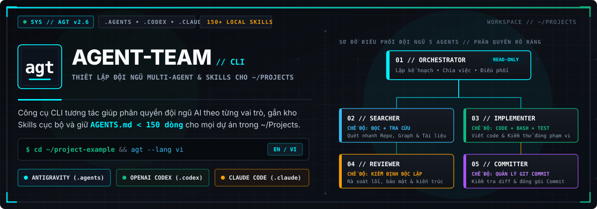

<div align="center">
  
  <br />
  <br />
  <p>
    <a href="./README.md">English</a> | <strong>Tiếng Việt</strong>
  </p>
  <p>
    <a href="./LICENSE"></a>
    <a href="https://www.python.org/"></a>
    
    
  </p>
</div>

`agt` (`agent-team`) là công cụ CLI tương tác (không phụ thuộc thư viện ngoài) giúp bạn thiết lập một **Đội ngũ AI 2 Pha 8 Vai Trò** (**lead-architect**, **lead-critic**, **orchestrator**, **reviewer**, **designer**, **implementer**, **searcher**, **committer**) cho từng dự án trong `~/Projects`, đồng thời đảm bảo `AGENTS.md` luôn gọn gàng **dưới 150 dòng (< 150 lines)**.

Khi chạy lệnh `agt`, giao diện dòng lệnh Tiếng Việt sẽ hỏi từng bước về:
- **Nhiệm vụ riêng (Mission)** của từng agent
- **Provider & Model** (`gemini-4-argon-high`, `claude-opus-5-5-medium`, `gemini-3.1-pro-high`, `gemini-3.8-flash-high`, `gpt-6-astra`, `gpt-6.1-sol`, `gpt-6-sol`, `gpt-6-luna`...)
- **Ngữ cảnh (Context/Scope)** & **Mục tiêu/Tiêu chí hoàn thành (Completion Criteria)**
- **Quyền công cụ** (`Read-Only` vs `Read+Write+Bash`, `Subagent Dispatch`, `Workspace Isolation`)
- **Tự động quét & gắn Skills** từ kho skills sẵn có trên máy của bạn (`~/.gemini/config/plugins/*`, `~/Projects/Hephaestus/.agents/skills/*`, `superpowers`, `mattpocock-skills`, `ponytail`, `ui-ux-pro-max`, `taste-skill`, `native_swarm`...) vào từng repo.

---

## 1. Các Repo Mã Nguồn Mở Liên Quan (Tham khảo)

Nếu bạn muốn tham khảo thêm các bộ sưu tập mẫu từ cộng đồng:
1. **[`wshobson/agents`](https://github.com/wshobson/agents)**: Kho sưu tập hơn 100+ subagents và skills đa nền tảng (Claude Code, Codex, Antigravity, Cursor).
2. **[`obra/superpowers`](https://github.com/obra/superpowers)** *(Đã cài sẵn trên máy bạn tại `~/.gemini/config/plugins/superpowers`)*: Hệ thống workflow chuẩn (`brainstorming`, `writing-plans`, `subagent-driven-development`, `dispatching-parallel-agents`, `test-driven-development`).
3. **[`mattpocock/skills`](https://github.com/mattpocock/skills)** *(Đã cài sẵn tại `~/.gemini/config/plugins/mattpocock-skills`)*: Bộ kỹ năng chuyên sâu cho `code-review` (song song 2 trục Spec & Standards), `tdd`, `codebase-design`, `writing-for-agents`.
4. **[`VoltAgent/awesome-claude-code-subagents`](https://github.com/VoltAgent/awesome-claude-code-subagents)**: Danh sách các mẫu `.claude/agents/*.md` chia theo từng vai trò kỹ thuật.
5. **[`intellectronica/ruler`](https://github.com/intellectronica/ruler)**: Công cụ đồng bộ file quy tắc ra `AGENTS.md`, `CLAUDE.md`.

> **Điểm khác biệt của `agt`**: Thay vì chỉ chép các mẫu tĩnh, `agt` là **Interactive Wizard** có giao diện Tiếng Việt trực quan, đặt câu hỏi riêng cho từng dự án trong `~/Projects`, kết nối trực tiếp với kho **150+ Skills đang cài trên máy bạn**, giữ `AGENTS.md` luôn **< 150 lines**, và xuất đồng thời cả 3 chuẩn (`agy`, `codex`, `claude`) để bạn điều phối ngay trong công cụ đang mở.

---

## 2. Cài Đặt & Sử Dụng Nhanh

### Cài đặt bằng 1 lệnh `curl` duy nhất

```bash
curl -fsSL https://raw.githubusercontent.com/rcryan-hniht/agent-team/main/install.sh | bash
```

Công cụ được cài và liên kết vào `~/.local/bin/agt`. Bạn có thể gõ lệnh từ bất kỳ đâu:

### A. Ví dụ mở Menu Giao Diện Dòng Lệnh (Tiếng Anh mặc định / Tiếng Việt `--lang vi`)
```bash
cd ~/project-example
agt             # Mặc định hiển thị Tiếng Anh (English)
agt --lang vi   # Mở giao diện dòng lệnh hoàn toàn bằng Tiếng Việt
```
- Khi đứng tại thư mục dự án (ví dụ `~/project-example`) và gõ `agt`, CLI sẽ hỏi bạn có muốn thiết lập Multi-Agent cho thư mục đó không, tự động nhận diện ngôn ngữ/framework và hỏi từng bước thiết lập.
- Nếu gõ tại `~/Projects`, CLI sẽ liệt kê toàn bộ các repo con để bạn chọn repo muốn thiết lập.

### B. Tạo nhanh bằng Preset (Không cần hỏi đáp)
```bash
agt init --target ~/project-example --yes \
  --goal "Xây dựng và tối ưu hệ thống với đội ngũ 8 vai trò"
```

### C. Giám sát Agents/Tasks đang chạy, Trạng thái đội AI & Danh sách Skills
```bash
# Kiểm tra tiến trình Agents, subagents và checklist task đang chạy
agt ps --target ~/project-example --lang vi

# Kiểm tra đội hình AI và skills đã gắn trong một repo
agt status --target ~/project-example

# Liệt kê tất cả skills đang có trên máy theo từng plugin
agt list-skills

# Chuyển đổi ngôn ngữ giao diện CLI (vi / en)
agt --lang vi
agt --lang en
```

### D. Chuỗi lùi Model & Provider dự phòng (Fallback Chain)
Mỗi agent có một chuỗi fallback theo thứ tự. Ví dụ chuỗi mặc định của `orchestrator`:

`agy:gemini-4-argon-high → agy:claude-opus-5-5-medium → agy:gemini-3.8-flash-high → codex:gpt-6.1-sol (xhigh)`

```bash
# Trình quản lý tương tác: xem, sửa, áp preset hoặc lùi model
agt fallback --target ~/project-example --lang vi

# Argon hết quota: chuyển orchestrator sang model kế tiếp (Opus 5.5)
agt fallback --target ~/project-example --step-down orchestrator

# Lùi tất cả agents xuống một bậc
agt fallback --target ~/project-example --step-down all

# Đặt chuỗi tùy chỉnh cho một role
agt fallback --target ~/project-example --role reviewer \
  --chain "agy:gemini-3.1-pro-high -> agy:claude-opus-5-5-medium -> codex:gpt-6.1-sol (xhigh)"
```

`--step-down` xoay vòng chuỗi, ghi lại `agent.md` (tier Antigravity), `agent.toml` (model Codex + reasoning effort) và `.claude/agents/*.md`, rồi lưu thứ tự mới vào `.agents/team-config.json`. Chuỗi fallback cũng được ghi vào hướng dẫn của từng agent.

---

## 3. Bảng Đội Hình 8 Vai Trò & Ánh Xạ Mô Hình

| Vai trò | Đường dẫn Workspace | Model mặc định (`agy`) | Model mặc định (`codex`) | Chế độ | Mục tiêu |
| :--- | :--- | :--- | :--- | :--- | :--- |
| **`lead-architect`** | `.agents/agents/lead-architect/agent.md` | `gemini-4-argon-high` / `claude-opus-5-5-medium` | `gpt-6-astra` (`high`) | Read-Only | Pha 1: Kiến trúc giải pháp, thông số kỹ thuật và phân rã task |
| **`lead-critic`** | `.agents/agents/lead-critic/agent.md` | `gemini-3.1-pro-high` / `claude-opus-5-5-medium` | `gpt-6.1-sol` (`xhigh`) | Read-Only | Pha 1: Phản biện 2 vòng, stress-test giả định và kiểm chứng YAGNI |
| **`orchestrator`** | `.agents/agents/orchestrator/agent.md` | `gemini-4-argon-high` / `claude-opus-5-5-medium` | `gpt-6-astra` (`high`) | Read/Coord | Pha 2: Tổng điều phối thực thi, phân công task và kiểm chứng tích hợp |
| **`reviewer`** | `.agents/agents/reviewer/agent.md` | `gemini-3.1-pro-high` | `gpt-6.1-sol` (`xhigh`) | Read-Only | Pha 2: Kiểm định độc lập 2 trục theo Spec, Bảo mật và Chất lượng test |
| **`designer`** | `.agents/agents/designer/agent.md` | `gemini-3.8-flash-high` | `gpt-6-sol` (`xhigh`) | Read+Write | Pha 2: Kỹ sư thiết kế UI/UX & bản sắc thị giác Anti-Slop |
| **`implementer`** | `.agents/agents/implementer/agent.md` | `gemini-3.8-flash-high` | `gpt-6-sol` (`xhigh`) | Read+Write | Pha 2: Thực thi code tối giản theo chuẩn TDD (Red-Green-Refactor) |
| **`searcher`** | `.agents/agents/searcher/agent.md` | `gemini-3.8-flash-medium` | `gpt-6-luna` (`medium`) | Read-Only | Pha 2: Trinh sát codebase nhanh và tra cứu tài liệu sơ cấp |
| **`committer`** | `.agents/agents/committer/agent.md` | `gemini-3.7-flash` | `gpt-6-luna` (`low`) | Read-Only | Pha 2: Đóng gói commit chuẩn atomic Conventional Commits |

---

## 🔄 Điều Phối Host-Native & Giao Thức Thực Thi

1. **Không Custom Runtime**: `agt` hoạt động thuần túy là bộ scaffold và generator đa harness. Hệ thống chạy bằng cơ chế điều phối native của host (`agy` subagents, `codex` `[agents]` threads, và `claude` agent markdown) mà không tạo runtime daemon hay process giả lập agent riêng để mô phỏng vai trò.
2. **Giao Thức Đồng Thời & Thứ Tự Thực Thi**: Cho phép fan-out các tác vụ đọc độc lập (`searcher`) chạy song song để tăng tốc độ khám phá. Ngược lại, các tác vụ sửa file chung giữa `implementer` và `designer` phải tuân thủ nghiêm ngặt nguyên tắc đơn ghi (single-writer) tuần tự, tiếp nối bởi kiểm định độc lập (`reviewer`) và đóng gói commit (`committer`).
3. **Ranh Giới Quyết Định Workflow Graph**: Mô hình máy trạng thái dạng đồ thị (workflow graph) không bắt buộc cho quy trình phát triển thông thường. Chỉ cân nhắc tích hợp workflow graph khi môi trường thực thi yêu cầu: thực thi cổng kiểm soát (gate enforcement), lưu/khôi phục state bền vững qua đĩa, hoặc quản lý chu trình retry sửa lỗi có hệ thống.

---

## 4. Cấu Trúc File Được Sinh Ra Tự Động Cho Mỗi Project

```text
<project-root>/
├── AGENTS.md                                  # Chuẩn chung (< 150 dòng) cho OpenAI Codex, Antigravity, Claude
├── CLAUDE.md                                  # Entrypoint cho Anthropic Claude Code
├── .agents/
│   ├── README.md                              # Bảng ánh xạ đầy đủ Role ↔ Model (Agy & Codex) ↔ Skills
│   ├── agents.json                            # Danh mục đăng ký subagents cho Antigravity (agy)
│   ├── skills.json                            # Đăng ký & lọc (include_only) các skills cho repo
│   ├── team-config.json                       # Lưu cấu hình để chỉnh sửa lại bất cứ lúc nào
│   ├── rules/
│   │   └── commit-restrictions.md             # (Tùy chọn) Chặn commit nhầm AGENTS.md / SKILL.md
│   ├── agents/
│   │   ├── lead-architect/ (agent.md, agent.toml) # Pha 1: Kiến trúc sư trưởng & Đề xuất giải pháp
│   │   ├── lead-critic/ (agent.md, agent.toml)    # Pha 1: Phản biện trưởng & Stress-test 2 vòng
│   │   ├── orchestrator/ (agent.md, agent.toml)   # Pha 2: Tổng điều phối thực thi
│   │   ├── reviewer/ (agent.md, agent.toml)       # Pha 2: Kiểm định độc lập chất lượng & bảo mật
│   │   ├── designer/ (agent.md, agent.toml)       # Pha 2: Kỹ sư thiết kế UI/UX & Anti-Slop
│   │   ├── implementer/ (agent.md, agent.toml)    # Pha 2: Kỹ sư TDD thực thi
│   │   ├── searcher/ (agent.md, agent.toml)       # Pha 2: Trinh sát mã nguồn & tra cứu tài liệu
│   │   └── committer/ (agent.md, agent.toml)      # Pha 2: Đóng gói Conventional Commits
│   ├── subagents/                             # Payload define_subagent / invoke_subagent Antigravity
│   │   ├── lead-architect.json (.md)
│   │   ├── lead-critic.json (.md)
│   │   ├── orchestrator.json (.md)
│   │   ├── reviewer.json (.md)
│   │   ├── designer.json (.md)
│   │   ├── implementer.json (.md)
│   │   ├── searcher.json (.md)
│   │   └── committer.json (.md)
│   └── skills/                                # Các skills được symlink hoặc copy vào dự án
├── .claude/
│   └── agents/
│       ├── lead-architect.md                  # Subagent YAML frontmatter chuẩn Claude Code
│       ├── lead-critic.md
│       ├── orchestrator.md
│       ├── reviewer.md
│       ├── designer.md
│       ├── implementer.md
│       ├── searcher.md
│       └── committer.md
└── .codex/
    └── config.toml                            # Cấu hình [agents.<role>] chuẩn cho OpenAI Codex CLI
```

---

## 5. Giấy phép (License)

Phát hành dưới giấy phép [MIT License](./LICENSE).
